# Respostas — Trabalho Prático da Segunda Unidade

> Preencha os campos indicados e acrescente linhas às tabelas conforme necessário. Mantenha o código dos testes em `src/test/java` e os relatórios originais e logs em `evidencias/`, referenciados por links relativos neste arquivo. Consulte os requisitos completos no [enunciado](ENUNCIADO.md).

## Identificação dos alunos

| Integrante | Nome completo | Matrícula |
|---|---|---|
| Aluno(a) 1 | Gustavo Fernando | 20230032521 |
| Aluno(a) 2  | Ian Silva | 20240022663 |

- Turma: T01
- Data: 06/11/2026
- `artifactId`: GustavoFernando_IanSilva

## 5.1. Cobertura de arestas

Classe: `CoberturaArestasTest.java`. Registre os resultados de sua execução isolada.

### Grafo de fluxo de controle

O Grafo de Fluxo de Controle (CFG) a seguir mapeia rigorosamente todas as decisões e instruções do método `calcularCustoLocacao`. 

**Convenções Adotadas:**
* **Nó de Entrada (`START`):** Representa o ponto de entrada único da função `calcularCustoLocacao`.
* **Nós de Decisão/Condição (`N1` a `N24`):** Representam avaliações lógicas atômicas. Condições compostas ligadas por curto-circuito (`||` e `&&`) são desmembradas em nós de decisão sequenciais individuais.
* **Nós de Processamento (`P1` a `P25`):** Blocos sequenciais de atribuição e cálculo de variáveis.
* **Nó de Saída Normal (`EXIT`):** Término de execução bem-sucedido via instrução `return`.
* **Nós de Exceção (`E_NPE` e `E_IAE`):** Término abrupto do método via lançamento de exceção (`throw`).

```mermaid
graph TD
    START([INÍCIO: calcularCustoLocacao])
    EXIT([FIM: Retorna Total])
    E_NPE([SAÍDA: NullPointerException])
    E_IAE([SAÍDA: IllegalArgumentException])

    N1{categoria == null?}
    N2{nivelCliente == null?}
    N3{seguro == null?}
    N4{numeroDiarias <= 0?}
    N5{quilometrosRodados < 0?}
    N6{horasAtraso < 0?}
    N7{categoria == ECONOMICO?}
    N8{categoria == INTERMEDIARIO?}
    P1[valorDiaria = 120.00]
    P2[valorDiaria = 180.00]
    P3[valorDiaria = 280.00]
    N9{numeroDiarias <= 2?}
    N10{numeroDiarias <= 6?}
    N11{numeroDiarias <= 14?}
    P4[taxaDuracao = 0]
    P5[taxaDuracao = 0.05]
    P6[taxaDuracao = 0.10]
    P7[taxaDuracao = 0.15]
    P8[Calcula valorDiariasComDesconto]
    N12{nivel == PRATA?}
    N13{diarias >= 7?}
    N14{!possuiAtrasoAnterior?}
    N15{nivel == OURO?}
    N16{diarias >= 5?}
    N17{!possuiAtrasoAnterior?}
    P9[taxaFidelidade = 0.05]
    P10[taxaFidelidade = 0.10]
    P11[taxaFidelidade = 0]
    P12[Calcula valorFinalDiarias e Franquia]
    N18{excedente <= 0?}
    N19{excedente <= 100?}
    N20{excedente <= 300?}
    P13[custoQuilometragem = 0]
    P14[tarifa = 0.80]
    P15[tarifa = 1.00]
    P16[tarifa = 1.50]
    P17[Calcula custoQuilometragem]
    N21{seguro == SEM_SEGURO?}
    N22{seguro == BASICO?}
    P18[valorSeguroDiaria = 0]
    P19[valorSeguroDiaria = 25.00]
    P20[valorSeguroDiaria = 45.00]
    P21[Calcula custoSeguro]
    N23{horasAtraso <= 1?}
    N24{horasAtraso <= 3?}
    P22[custoAtraso = 0]
    P23["custoAtraso = 20% diária * horas"]
    P24[custoAtraso = 1 diária]
    P25[Soma Total e return]

    START --> N1
    N1 -->|Sim| E_NPE
    N1 -->|Não| N2
    N2 -->|Sim| E_NPE
    N2 -->|Não| N3
    N3 -->|Sim| E_NPE
    N3 -->|Não| N4
    N4 -->|Sim| E_IAE
    N4 -->|Não| N5
    N5 -->|Sim| E_IAE
    N5 -->|Não| N6
    N6 -->|Sim| E_IAE
    N6 -->|Não| N7
    N7 -->|Sim| P1
    N7 -->|Não| N8
    N8 -->|Sim| P2
    N8 -->|Não| P3
    P1 --> N9
    P2 --> N9
    P3 --> N9
    N9 -->|Sim| P4
    N9 -->|Não| N10
    N10 -->|Sim| P5
    N10 -->|Não| N11
    N11 -->|Sim| P6
    N11 -->|Não| P7
    P4 --> P8
    P5 --> P8
    P6 --> P8
    P7 --> P8
    P8 --> N12
    N12 -->|Sim| N13
    N13 -->|Sim| N14
    N14 -->|Sim| P9
    N12 -->|Não| N15
    N13 -->|Não| N15
    N14 -->|Não| N15
    N15 -->|Sim| N16
    N16 -->|Sim| N17
    N17 -->|Sim| P10
    N15 -->|Não| P11
    N16 -->|Não| P11
    N17 -->|Não| P11
    P9 --> P12
    P10 --> P12
    P11 --> P12
    P12 --> N18
    N18 -->|Sim| P13
    N18 -->|Não| N19
    N19 -->|Sim| P14
    P14 --> P17
    N19 -->|Não| N20
    N20 -->|Sim| P15
    P15 --> P17
    N20 -->|Não| P16
    P16 --> P17
    P13 --> N21
    P17 --> N21
    N21 -->|Sim| P18
    N21 -->|Não| N22
    N22 -->|Sim| P19
    N22 -->|Não| P20
    P18 --> P21
    P19 --> P21
    P20 --> P21
    P21 --> N23
    N23 -->|Sim| P22
    N23 -->|Não| N24
    N24 -->|Sim| P23
    N24 -->|Não| P24
    P22 --> P25
    P23 --> P25
    P24 --> P25
    P25 --> EXIT
```

### Identificação dos nós e das arestas

| Nó | Trecho ou linhas do código | Descrição |
|---|---|---|
| `START` | Linha 7 | Ponto de entrada do método `calcularCustoLocacao` |
| `N1` | Linha 9 | Condição `categoria == null` (Disjunção 1) |
| `N2` | Linha 9 | Condição `nivelCliente == null` (Disjunção 2) |
| `N3` | Linha 9 | Condição `seguro == null` (Disjunção 3) |
| `E_NPE` | Linha 11 | `throw new NullPointerException(...)` |
| `N4` | Linha 14 | Condição `numeroDiarias <= 0` |
| `N5` | Linha 19 | Condição `quilometrosRodados < 0` |
| `N6` | Linha 24 | Condição `horasAtraso < 0` |
| `E_IAE` | Linhas 16, 21, 26 | `throw new IllegalArgumentException(...)` |
| `N7` | Linha 30 | Condição `categoria == CategoriaVeiculo.ECONOMICO` |
| `P1` | Linha 32 | `valorDiaria = new BigDecimal("120.00")` |
| `N8` | Linha 34 | Condição `categoria == CategoriaVeiculo.INTERMEDIARIO` |
| `P2` | Linha 36 | `valorDiaria = new BigDecimal("180.00")` |
| `P3` | Linha 40 | `valorDiaria = new BigDecimal("280.00")` |
| `N9` | Linha 44 | Condição `numeroDiarias <= 2` |
| `P4` | Linha 46 | `taxaDescontoDuracao = BigDecimal.ZERO` |
| `N10` | Linha 48 | Condição `numeroDiarias <= 6` |
| `P5` | Linha 50 | `taxaDescontoDuracao = new BigDecimal("0.05")` |
| `N11` | Linha 52 | Condição `numeroDiarias <= 14` |
| `P6` | Linha 54 | `taxaDescontoDuracao = new BigDecimal("0.10")` |
| `P7` | Linha 58 | `taxaDescontoDuracao = new BigDecimal("0.15")` |
| `P8` | Linhas 61-63 | Atribuição `valorBrutoDiarias`, `descontoDuracao`, `valorDiariasComDesconto` |
| `N12` | Linha 67 | Condição `nivelCliente == NivelCliente.PRATA` |
| `N13` | Linha 67 | Condição `numeroDiarias >= 7` |
| `N14` | Linha 67 | Condição `!possuiAtrasoAnterior` |
| `P9` | Linha 69 | `taxaDescontoFidelidade = new BigDecimal("0.05")` |
| `N15` | Linha 71 | Condição `nivelCliente == NivelCliente.OURO` |
| `N16` | Linha 71 | Condição `numeroDiarias >= 5` |
| `N17` | Linha 71 | Condição `!possuiAtrasoAnterior` |
| `P10` | Linha 73 | `taxaDescontoFidelidade = new BigDecimal("0.10")` |
| `P11` | Linha 77 | `taxaDescontoFidelidade = BigDecimal.ZERO` |
| `P12` | Linhas 80-85 | Atribuição `descontoFidelidade`, `valorFinalDiarias`, `franquiaQuilometros` e `quilometrosExcedentes` |
| `N18` | Linha 87 | Condição `quilometrosExcedentes <= 0` |
| `P13` | Linha 89 | `custoQuilometragem = BigDecimal.ZERO` |
| `N19` | Linha 94 | Condição `quilometrosExcedentes <= 100` |
| `P14` | Linha 96 | `tarifaQuilometrica = new BigDecimal("0.80")` |
| `N20` | Linha 98 | Condição `quilometrosExcedentes <= 300` |
| `P15` | Linha 100 | `tarifaQuilometrica = new BigDecimal("1.00")` |
| `P16` | Linha 104 | `tarifaQuilometrica = new BigDecimal("1.50")` |
| `P17` | Linha 106 | `custoQuilometragem = BigDecimal.valueOf(...).multiply(...)` |
| `N21` | Linha 110 | Condição `seguro == TipoSeguro.SEM_SEGURO` |
| `P18` | Linha 112 | `valorSeguroDiaria = BigDecimal.ZERO` |
| `N22` | Linha 114 | Condição `seguro == TipoSeguro.BASICO` |
| `P19` | Linha 116 | `valorSeguroDiaria = new BigDecimal("25.00")` |
| `P20` | Linha 120 | `valorSeguroDiaria = new BigDecimal("45.00")` |
| `P21` | Linha 122 | `custoSeguro = valorSeguroDiaria.multiply(...)` |
| `N23` | Linha 125 | Condição `horasAtraso <= 1` |
| `P22` | Linha 127 | `custoAtraso = BigDecimal.ZERO` |
| `N24` | Linha 129 | Condição `horasAtraso <= 3` |
| `P23` | Linha 131 | `custoAtraso = valorDiaria.multiply(...)` |
| `P24` | Linha 135 | `custoAtraso = valorDiaria` |
| `P25` | Linha 138 | Atribuição de `total` e arredondamento em `return total.setScale(...)` |
| `EXIT` | Linha 139 | Saída bem-sucedida do método |

| Aresta | Origem | Destino | Condição ou fluxo |
|---|---|---|---|
| A01 | `START` | `N1` | Entrada no método |
| A02 | `N1` | `E_NPE` | `categoria == null` (Sim) |
| A03 | `N1` | `N2` | `categoria != null` (Não) |
| A04 | `N2` | `E_NPE` | `nivelCliente == null` (Sim) |
| A05 | `N2` | `N3` | `nivelCliente != null` (Não) |
| A06 | `N3` | `E_NPE` | `seguro == null` (Sim) |
| A07 | `N3` | `N4` | `seguro != null` (Não) |
| A08 | `N4` | `E_IAE` | `numeroDiarias <= 0` (Sim) |
| A09 | `N4` | `N5` | `numeroDiarias > 0` (Não) |
| A10 | `N5` | `E_IAE` | `quilometrosRodados < 0` (Sim) |
| A11 | `N5` | `N6` | `quilometrosRodados >= 0` (Não) |
| A12 | `N6` | `E_IAE` | `horasAtraso < 0` (Sim) |
| A13 | `N6` | `N7` | `horasAtraso >= 0` (Não) |
| A14 | `N7` | `P1` | `categoria == ECONOMICO` (Sim) |
| A15 | `N7` | `N8` | `categoria != ECONOMICO` (Não) |
| A16 | `N8` | `P2` | `categoria == INTERMEDIARIO` (Sim) |
| A17 | `N8` | `P3` | categoria != INTEREDIARIO` (Não) |
| A18 | `P1` | `N9` | Fluxo normal após P1 |
| A19 | `P2` | `N9` | Fluxo normal após P2 |
| A20 | `P3` | `N9` | Fluxo normal após P3 |
| A21 | `N9` | `P4` | `numeroDiarias <= 2` (Sim) |
| A22 | `N9` | `N10` | `numeroDiarias > 2` (Não) |
| A23 | `N10` | `P5` | `numeroDiarias <= 6` (Sim) |
| A24 | `N10` | `N11` | `numeroDiarias > 6` (Não) |
| A25 | `N11` | `P6` | `numeroDiarias <= 14` (Sim) |
| A26 | `N11` | `P7` | `numeroDiarias > 14` (Não) |
| A27 | `P4` | `P8` | Fluxo normal para P8 |
| A28 | `P5` | `P8` | Fluxo normal para P8 |
| A29 | `P6` | `P8` | Fluxo normal para P8 |
| A30 | `P7` | `P8` | Fluxo normal para P8 |
| A31 | `P8` | `N12` | Fluxo normal para N12 |
| A32 | `N12` | `N13` | `nivelCliente == PRATA` (Sim) |
| A33 | `N12` | `N15` | `nivelCliente != PRATA` (Não) |
| A34 | `N13` | `N14` | `numeroDiarias >= 7` (Sim) |
| A35 | `N13` | `N15` | `numeroDiarias < 7` (Não) |
| A36 | `N14` | `P9` | `!possuiAtrasoAnterior` (Sim) |
| A37 | `N14` | `N15` | `possuiAtrasoAnterior` (Não) |
| A38 | `N15` | `N16` | `nivelCliente == OURO` (Sim) |
| A39 | `N15` | `P11` | `nivelCliente != OURO` (Não) |
| A40 | `N16` | `N17` | `numeroDiarias >= 5` (Sim) |
| A41 | `N16` | `P11` | `numeroDiarias < 5` (Não) |
| A42 | `N17` | `P10` | `!possuiAtrasoAnterior` (Sim) |
| A43 | `N17` | `P11` | `possuiAtrasoAnterior` (Não) |
| A44 | `P9` | `P12` | Fluxo normal para P12 |
| A45 | `P10` | `P12` | Fluxo normal para P12 |
| A46 | `P11` | `P12` | Fluxo normal para P12 |
| A47 | `P12` | `N18` | Fluxo normal para N18 |
| A48 | `N18` | `P13` | `quilometrosExcedentes <= 0` (Sim) |
| A49 | `N18` | `N19` | `quilometrosExcedentes > 0` (Não) |
| A50 | `N19` | `P14` | `quilometrosExcedentes <= 100` (Sim) |
| A51 | `N19` | `N20` | `quilometrosExcedentes > 100` (Não) |
| A52 | `N20` | `P15` | `quilometrosExcedentes <= 300` (Sim) |
| A53 | `N20` | `P16` | `quilometrosExcedentes > 300` (Não) |
| A54 | `P14` | `P17` | Fluxo normal para P17 |
| A55 | `P15` | `P17` | Fluxo normal para P17 |
| A56 | `P16` | `P17` | Fluxo normal para P17 |
| A57 | `P13` | `N21` | Fluxo normal para N21 |
| A58 | `P17` | `N21` | Fluxo normal para N21 |
| A59 | `N21` | `P18` | `seguro == SEM_SEGURO` (Sim) |
| A60 | `N21` | `N22` | `seguro != SEM_SEGURO` (Não) |
| A61 | `N22` | `P19` | `seguro == BASICO` (Sim) |
| A62 | `N22` | `P20` | `seguro == PREMIUM/COMPLETO` (Não) |
| A63 | `P18` | `P21` | Fluxo normal para P21 |
| A64 | `P19` | `P21` | Fluxo normal para P21 |
| A65 | `P20` | `P21` | Fluxo normal para P21 |
| A66 | `P21` | `N23` | Fluxo normal para N23 |
| A67 | `N23` | `P22` | `horasAtraso <= 1` (Sim) |
| A68 | `N23` | `N24` | `horasAtraso > 1` (Não) |
| A69 | `N24` | `P23` | `horasAtraso <= 3` (Sim) |
| A70 | `N24` | `P24` | `horasAtraso > 3` (Não) |
| A71 | `P22` | `P25` | Fluxo normal para P25 |
| A72 | `P23` | `P25` | Fluxo normal para P25 |
| A73 | `P24` | `P25` | Fluxo normal para P25 |
| A74 | `P25` | `EXIT` | Retorno com valor calculado |

### Casos de teste e rastreabilidade
| Caso | Entradas                                            | Resultado ou exceção esperados | Justificativa do resultado esperado                                                                                                                                           | Arestas percorridas                                                                                                                                                   | Teste JUnit / invocação                                                                                 |
| ---- | --------------------------------------------------- | ------------------------------ | ----------------------------------------------------------------------------------------------------------------------------------------------------------------------------- | --------------------------------------------------------------------------------------------------------------------------------------------------------------------- | ------------------------------------------------------------------------------------------------------- |
| CT01 | `(null, COMUM, -1, -50, -2, SEM_SEGURO, false)`     | `NullPointerException`         | A categoria é nula; a validação da categoria ocorre primeiro.                                                                                                                 | `A01, A02`                                                                                                                                                            | `deveLancarNullPointerExceptionQuandoCategoriaForNula`                                                  |
| CT02 | `(ECONOMICO, null, 0, -10, 0, BASICO, false)`       | `NullPointerException`         | O nível do cliente é nulo; essa validação ocorre antes da validação das diárias.                                                                                              | `A01, A03, A04`                                                                                                                                                       | `deveLancarNullPointerExceptionQuandoNivelClienteForNulo`                                               |
| CT03 | `(INTERMEDIARIO, PRATA, 5, 100, 1, null, false)`    | `NullPointerException`         | O tipo de seguro é nulo.                                                                                                                                                      | `A01, A03, A05, A06`                                                                                                                                                  | `deveLancarNullPointerExceptionQuandoSeguroForNulo`                                                     |
| CT04 | `(ECONOMICO, COMUM, 0, 100, 0, BASICO, false)`      | `IllegalArgumentException`     | O número de diárias é zero, violando a condição `numeroDiarias > 0`.                                                                                                          | `A01, A03, A05, A07, A08`                                                                                                                                             | `deveLancarIllegalArgumentExceptionQuandoDiariasForemZero`                                              |
| CT05 | `(ECONOMICO, COMUM, 3, -1, 0, BASICO, false)`       | `IllegalArgumentException`     | A quilometragem informada é negativa.                                                                                                                                         | `A01, A03, A05, A07, A09, A10`                                                                                                                                        | `deveLancarIllegalArgumentExceptionQuandoKmRodadosForemNegativos`                                       |
| CT06 | `(ECONOMICO, COMUM, 3, 100, -1, BASICO, false)`     | `IllegalArgumentException`     | O número de horas de atraso é negativo.                                                                                                                                       | `A01, A03, A05, A07, A09, A11, A12`                                                                                                                                   | `deveLancarIllegalArgumentExceptionQuandoHorasAtrasoForemNegativas`                                     |
| CT07 | `(ECONOMICO, PRATA, 7, 700, 1, SEM_SEGURO, false)`  | `BigDecimal("718.20")`         | Diárias: 120 × 7 = 840. Desconto de duração de 10%: 756. Desconto Prata de 5%: 718,20. A quilometragem está dentro do limite e uma hora de atraso não gera cobrança.          | `A01, A03, A05, A07, A09, A11, A13, A14, A18, A22, A24, A25, A29, A31, A32, A34, A36, A44, A47, A48, A57, A59, A63, A66, A67, A71, A74`                               | `deveCalcularLocacaoEconomicaComDescontoPrataEUmaHoraDeAtraso`                                          |
| CT08 | `(ECONOMICO, PRATA, 14, 700, 0, SEM_SEGURO, false)` | `BigDecimal("1436.40")`        | Diárias: 120 × 14 = 1.680. Desconto de duração de 10%: 1.512. Desconto Prata de 5%: 1.436,40. Não há excedente de quilometragem nem atraso.                                   | `A01, A03, A05, A07, A09, A11, A13, A14, A18, A22, A24, A25, A29, A31, A32, A34, A36, A44, A47, A48, A57, A59, A63, A66, A67, A71, A74`                               | `deveCalcularLocacaoEconomicaComDescontoPrataParaQuatorzeDias`                                          |
| CT09 | `(INTERMEDIARIO, OURO, 5, 800, 2, BASICO, false)`   | `BigDecimal("1266.50")`        | Diárias: 180 × 5 = 900. Desconto de duração de 5%: 855. Desconto Ouro de 10%: 769,50. Excedente: 300 km × 1,00 = 300. Seguro: 25 × 5 = 125. Atraso: 40% de 180 = 72.          | `A01, A03, A05, A07, A09, A11, A13, A15, A16, A19, A22, A23, A28, A31, A33, A38, A40, A42, A45, A47, A49, A51, A52, A55, A58, A60, A61, A64, A66, A68, A69, A72, A74` | `deveCalcularLocacaoIntermediariaComSeguroBasicoEAtrasoDeDuasHoras`                                     |
| CT10 | `(INTERMEDIARIO, OURO, 5, 799, 3, BASICO, false)`   | `BigDecimal("1301.50")`        | Diárias: 180 × 5 = 900. Desconto de duração de 5%: 855. Desconto Ouro de 10%: 769,50. Excedente: 299 km × 1,00 = 299. Seguro: 25 × 5 = 125. Atraso: 60% de 180 = 108.         | `A01, A03, A05, A07, A09, A11, A13, A15, A16, A19, A22, A23, A28, A31, A33, A38, A40, A42, A45, A47, A49, A51, A52, A55, A58, A60, A61, A64, A66, A68, A69, A72, A74` | `deveCalcularLocacaoIntermediariaComSeguroBasicoEAtrasoDeTresHoras`                                     |
| CT11 | `(SUV, COMUM, 2, 450, 5, COMPLETO, false)`          | `BigDecimal("1180.00")`        | Diárias: 280 × 2 = 560. Excedente: (450 − 200) × 1,00 = 250. Seguro completo: 45 × 2 = 90. Atraso superior a três horas: cobrança de uma diária, 280. Total: 1.180.           | `A01, A03, A05, A07, A09, A11, A13, A15, A17, A20, A21, A27, A31, A33, A39, A46, A47, A49, A51, A52, A55, A58, A60, A62, A65, A66, A68, A70, A73, A74`                | `deveCalcularLocacaoSUVComSeguroCompletoEAtrasoSuperiorATresHoras`                                      |
| CT12 | `(ECONOMICO, PRATA, 15, 2000, 0, SEM_SEGURO, true)` | `BigDecimal("2280.00")`        | Diárias: 120 × 15 = 1.800. Desconto de duração de 15%: 1.530. Não há desconto de fidelidade devido ao atraso anterior. Excedente: (2.000 − 1.500) × 1,50 = 750. Total: 2.280. | `A01, A03, A05, A07, A09, A11, A13, A14, A18, A22, A24, A26, A30, A31, A32, A34, A37, A46, A47, A49, A51, A53, A56, A58, A59, A63, A66, A67, A71, A74`                | `deveCalcularLocacaoEconomicaSemDescontoFidelidadePorAtrasoAnterior`                                    |
| CT13 | `(ECONOMICO, OURO, 4, 400, 0, SEM_SEGURO, false)`   | `BigDecimal("456.00")`         | Diárias: 120 × 4 = 480. Desconto de duração de 5%: 456. Não se aplica o desconto Ouro porque são menos de cinco diárias.                                                      | `A01, A03, A05, A07, A09, A11, A13, A14, A18, A22, A23, A28, A31, A33, A38, A41, A46, A47, A48, A57, A59, A63, A66, A67, A71, A74`                                    | `deveCalcularLocacaoEconomicaSemDescontoOuroPorDiariasInsuficientes`                                    |
| CT14 | `(ECONOMICO, OURO, 6, 600, 0, SEM_SEGURO, true)`    | `BigDecimal("684.00")`         | Diárias: 120 × 6 = 720. Desconto de duração de 5%: 684. Não se aplica o desconto Ouro devido ao atraso anterior.                                                              | `A01, A03, A05, A07, A09, A11, A13, A14, A18, A22, A23, A28, A31, A33, A38, A40, A43, A46, A47, A48, A57, A59, A63, A66, A67, A71, A74`                               | `deveCalcularLocacaoEconomicaSemDescontoOuroPorAtrasoAnterior`                                          |
| CT15 | `(ECONOMICO, PRATA, 2, 300, 0, SEM_SEGURO, false)`  | `BigDecimal("320.00")`         | Diárias: 120 × 2 = 240. Não há desconto de duração. Excedente: (300 − 200) × 0,80 = 80. Total: 320.                                                                           | `A01, A03, A05, A07, A09, A11, A13, A14, A18, A21, A27, A31, A32, A35, A46, A47, A49, A50, A54, A58, A59, A63, A66, A67, A71, A74`                                    | `deveCalcularLocacaoEconomicaSemDescontoPrataoPorDiariasInsuficientesECemQuilometrosExcedentes`         |
| CT16 | `(ECONOMICO, PRATA, 2, 299, 0, SEM_SEGURO, false)`  | `BigDecimal("319.20")`         | Diárias: 120 × 2 = 240. Não há desconto de duração. Excedente: (299 − 200) × 0,80 = 79,20. Total: 319,20.                                                                     | `A01, A03, A05, A07, A09, A11, A13, A14, A18, A21, A27, A31, A32, A35, A46, A47, A49, A50, A54, A58, A59, A63, A66, A67, A71, A74`                                    | `deveCalcularLocacaoEconomicaSemDescontoPrataoPorDiariasInsuficientesENoventaNoveQuilometrosExcedentes` |
| CT17 | `(ECONOMICO, PRATA, 2, 201, 0, SEM_SEGURO, false)`  | `BigDecimal("240.80")`         | Diárias: 120 × 2 = 240. Não há desconto de duração. Excedente: (201 − 200) × 0,80 = 0,80. Total: 240,80.                                                                      | `A01, A03, A05, A07, A09, A11, A13, A14, A18, A21, A27, A31, A32, A35, A46, A47, A49, A50, A54, A58, A59, A63, A66, A67, A71, A74`                                    | `deveCalcularLocacaoEconomicaSemDescontoPrataoPorDiariasInsuficientesEUmQuilometroExcedentes`           |

### Resultado da cobertura

| Medida | Resultado |
|---|---|
| Total de arestas do grafo | 74 |
| Arestas percorridas | 74 |
| Cobertura de arestas (%) | 100.00% |
| Ramos cobertos do método no JaCoCo | 32 |
| Ramos não cobertos do método no JaCoCo | 0 |
| Cobertura de ramos (%) | 100.00% |

Análise da correspondência entre grafo, testes e JaCoCo, incluindo exceções: Há uma perfeita correspondência de 1:1 entre as arestas lógicas do grafo e as ramificações de bytecodes compilados pelo JaCoCo. Como demonstrado no log do Maven (`Tests run: 17, Failures: 0, Errors: 0, Skipped: 0`), os 17 casos de teste cobrem todas as bifurcações de exceção por argumento nulo/inválido e todas as regras de negócio de descontos, seguros e atrasos, zerando os ramos não cobertos.

Evidências: `evidencias/jacoco/arestas/index.html`, `evidencias/jacoco/arestas/jacoco.xml`,`evidencias/log-arestas.log`.

## 5.2. Critério de McCabe

Classe: `CaminhosBasicosTest.java`. Registre os resultados de sua execução isolada.

### Complexidade ciclomática

| Elemento | Contagem |
|---|---|
| Nós (N) | 54 |
| Arestas (E) | 74 |
| Decisões binárias | 21 |

- Cálculo por `E - N + 2`: $74 - 54 + 2 = 22$.
- Cálculo por decisões binárias + 1: $21 + 1 = 22$.
- Convenção de saída única e tratamento do curto-circuito: Todas as saídas de exceção (`E_NPE` e `E_IAE`) foram conectadas ao fluxo conceitual de término do método, mantendo uma única entrada e saída global. Condições compostas foram desmembradas em decisões binárias simples atômicas.
- Comparação com a complexidade do método no JaCoCo e explicação de divergências: A complexidade reportada pelo JaCoCo corresponde ao número de pontos de decisão no bytecode (28 decisões binárias no nível de instrução compilada + 1 = 29), enquanto o grafo conceitual atomiza os operadores de curto-circuito adicionando decisões explícitas no nível de código Java, gerando $V(G) = 22$. Isso pode ocorrer por diferenças entre a representação do fluxo de controle no código-fonte e sua implementação em bytecode, como na avaliação de expressões com operadores de curto-circuito (&& e ||)

### Caminhos independentes e testes

Para facilitar a leitura, defino dois trechos recorrentes:

- A: `START → N1 → N2 → N3 → N4 → N5 → N6`
- T: `N18 → N19 → N20 → N21 → N22 → N23 → N24 → EXIT → EXIT_GLOBAL`

| Caminho | Sequência de nós                                                                                                                                                               | Caso / entradas                                        | Resultado esperado         | Teste JUnit / invocação               |
| ------- | ------------------------------------------------------------------------------------------------------------------------------------------------------------------------------ | ------------------------------------------------------ | -------------------------- | ------------------------------------- |
| P1      | `START → N1 (Sim) → E_NPE → EXIT_GLOBAL`                                                                                                                                       | `(null, COMUM, 1, 0, 0, SEM_SEGURO, false)`            | `NullPointerException`     | `testP1_CategoriaNula()`              |
| P2      | `START → N1 (Não) → N2 (Sim) → E_NPE → EXIT_GLOBAL`                                                                                                                            | `(ECONOMICO, null, 1, 0, 0, SEM_SEGURO, false)`        | `NullPointerException`     | `testP2_NivelClienteNulo()`           |
| P3      | `START → N1 (Não) → N2 (Não) → N3 (Sim) → E_NPE → EXIT_GLOBAL`                                                                                                                 | `(ECONOMICO, COMUM, 1, 0, 0, null, false)`             | `NullPointerException`     | `testP3_SeguroNulo()`                 |
| P4      | `START → N1 (Não) → N2 (Não) → N3 (Não) → N4 (Sim) → E_IAE → EXIT_GLOBAL`                                                                                                      | `(ECONOMICO, COMUM, 0, 0, 0, SEM_SEGURO, false)`       | `IllegalArgumentException` | `testP4_DiariasInvalidas()`           |
| P5      | `START → N1 (Não) → N2 (Não) → N3 (Não) → N4 (Não) → N5 (Sim) → E_IAE → EXIT_GLOBAL`                                                                                           | `(ECONOMICO, COMUM, 1, -1, 0, SEM_SEGURO, false)`      | `IllegalArgumentException` | `testP5_QuilometrosNegativos()`       |
| P6      | `START → N1 (Não) → N2 (Não) → N3 (Não) → N4 (Não) → N5 (Não) → N6 (Sim) → E_IAE → EXIT_GLOBAL`                                                                                | `(ECONOMICO, COMUM, 1, 0, -1, SEM_SEGURO, false)`      | `IllegalArgumentException` | `testP6_HorasAtrasoNegativas()`       |
| P7      | `START → N1 → N2 → N3 → N4 → N5 → N6 → N7 (Sim) → N9 (Sim) → N12 (Não) → N15 (Não) → N18 (Sim) → N21 (Sim) → N23 (Sim) → EXIT`                                                 | `(ECONOMICO, COMUM, 2, 200, 0, SEM_SEGURO, false)`     | `240.00`                   | `testP7_CaminhoBaseEconomico()`       |
| P8      | `START → N1 → N2 → N3 → N4 → N5 → N6 → N7 (Não) → N8 (Sim) → N9 (Sim) → N12 (Não) → N15 (Não) → N18 (Sim) → N21 (Sim) → N23 (Sim) → EXIT`                                      | `(INTERMEDIARIO, COMUM, 2, 200, 0, SEM_SEGURO, false)` | `360.00`                   | `testP8_CategoriaIntermediario()`     |
| P9      | `START → N1 → N2 → N3 → N4 → N5 → N6 → N7 (Não) → N8 (Não) → N9 (Sim) → N12 (Não) → N15 (Não) → N18 (Sim) → N21 (Sim) → N23 (Sim) → EXIT`                                      | `(SUV, COMUM, 2, 200, 0, SEM_SEGURO, false)`           | `560.00`                   | `testP9_CategoriaSUV()`               |
| P10     | `START → N1 → N2 → N3 → N4 → N5 → N6 → N7 (Sim) → N9 (Não) → N10 (Sim) → N12 (Não) → N15 (Não) → N18 (Sim) → N21 (Sim) → N23 (Sim) → EXIT`                                     | `(ECONOMICO, COMUM, 5, 500, 0, SEM_SEGURO, false)`     | `570.00`                   | `testP10_DescontoDuracao5PorCento()`  |
| P11     | `START → N1 → N2 → N3 → N4 → N5 → N6 → N7 (Sim) → N9 (Não) → N10 (Não) → N11 (Sim) → N12 (Não) → N15 (Não) → N18 (Sim) → N21 (Sim) → N23 (Sim) → EXIT`                         | `(ECONOMICO, COMUM, 10, 1000, 0, SEM_SEGURO, false)`   | `1080.00`                  | `testP11_DescontoDuracao10PorCento()` |
| P12     | `START → N1 → N2 → N3 → N4 → N5 → N6 → N7 (Sim) → N9 (Não) → N10 (Não) → N11 (Não) → N12 (Não) → N15 (Não) → N18 (Sim) → N21 (Sim) → N23 (Sim) → EXIT`                         | `(ECONOMICO, COMUM, 15, 1500, 0, SEM_SEGURO, false)`   | `1530.00`                  | `testP12_DescontoDuracao15PorCento()` |
| P13     | `START → N1 → N2 → N3 → N4 → N5 → N6 → N7 (Sim) → N9 (Não) → N10 (Não) → N11 (Sim) → N12 (Sim) → N13 (Sim) → N14 (Sim) → N18 (Sim) → N21 (Sim) → N23 (Sim) → EXIT`             | `(ECONOMICO, PRATA, 7, 700, 0, SEM_SEGURO, false)`     | `718.20`                   | `testP13_DescontoFidelidadePrata()`   |
| P14     | `START → N1 → N2 → N3 → N4 → N5 → N6 → N7 (Sim) → N9 (Não) → N10 (Sim) → N12 (Não) → N15 (Sim) → N16 (Sim) → N17 (Sim) → N18 (Sim) → N21 (Sim) → N23 (Sim) → EXIT`             | `(ECONOMICO, OURO, 5, 500, 0, SEM_SEGURO, false)`      | `513.00`                   | `testP14_DescontoFidelidadeOuro()`    |
| P15     | `START → N1 → N2 → N3 → N4 → N5 → N6 → N7 (Sim) → N9 (Sim) → N12 (Não) → N15 (Não) → N18 (Não) → N19 (Sim) → N21 (Sim) → N23 (Sim) → EXIT`                                     | `(ECONOMICO, COMUM, 2, 250, 0, SEM_SEGURO, false)`     | `280.00`                   | `testP15_ExcedenteKmAte100()`         |
| P16     | `START → N1 → N2 → N3 → N4 → N5 → N6 → N7 (Sim) → N9 (Sim) → N12 (Não) → N15 (Não) → N18 (Não) → N19 (Não) → N20 (Sim) → N21 (Sim) → N23 (Sim) → EXIT`                         | `(ECONOMICO, COMUM, 2, 400, 0, SEM_SEGURO, false)`     | `440.00`                   | `testP16_ExcedenteKm101Ate300()`      |
| P17     | `START → N1 → N2 → N3 → N4 → N5 → N6 → N7 (Sim) → N9 (Sim) → N12 (Não) → N15 (Não) → N18 (Não) → N19 (Não) → N20 (Não) → N21 (Sim) → N23 (Sim) → EXIT`                         | `(ECONOMICO, COMUM, 2, 600, 0, SEM_SEGURO, false)`     | `840.00`                   | `testP17_ExcedenteKmAcima300()`       |
| P18     | `START → N1 → N2 → N3 → N4 → N5 → N6 → N7 (Sim) → N9 (Sim) → N12 (Não) → N15 (Não) → N18 (Sim) → N21 (Não) → N22 (Sim) → N23 (Sim) → EXIT`                                     | `(ECONOMICO, COMUM, 2, 200, 0, BASICO, false)`         | `290.00`                   | `testP18_SeguroBasico()`              |
| P19     | `START → N1 → N2 → N3 → N4 → N5 → N6 → N7 (Sim) → N9 (Sim) → N12 (Não) → N15 (Não) → N18 (Sim) → N21 (Não) → N22 (Não) → N23 (Sim) → EXIT`                                     | `(ECONOMICO, COMUM, 2, 200, 0, COMPLETO, false)`       | `330.00`                   | `testP19_SeguroCompleto()`            |
| P20     | `START → N1 → N2 → N3 → N4 → N5 → N6 → N7 (Sim) → N9 (Não) → N10 (Sim) → N12 (Sim) → N13 (Não) → N15 (Não) → N18 (Sim) → N21 (Sim) → N23 (Sim) → EXIT`                         | `(ECONOMICO, PRATA, 5, 200, 0, SEM_SEGURO, false)`     | `570.00`                   | `testP20_PrataMenosSeteDiarias()`     |
| P21     | `START → N1 → N2 → N3 → N4 → N5 → N6 → N7 (Sim) → N9 (Não) → N10 (Não) → N11 (Sim) → N12 (Sim) → N13 (Sim) → N14 (Não) → N15 (Não) → N18 (Sim) → N21 (Sim) → N23 (Sim) → EXIT` | `(ECONOMICO, PRATA, 7, 200, 0, SEM_SEGURO, true)`      | `756.00`                   | `testP21_PrataComAtrasoAnterior()`    |
| P22     | `START → N1 → N2 → N3 → N4 → N5 → N6 → N7 (Sim) → N9 (Sim) → N12 (Não) → N15 (Sim) → N16 (Não) → N18 (Sim) → N21 (Sim) → N23 (Sim) → EXIT`                                     | `(ECONOMICO, OURO, 2, 200, 0, SEM_SEGURO, false)`      | `240.00`                   | `testP22_OuroMenosCincoDiarias()`     |
| P23     | `START → N1 → N2 → N3 → N4 → N5 → N6 → N7 (Sim) → N9 (Não) → N10 (Sim) → N12 (Não) → N15 (Sim) → N16 (Sim) → N17 (Não) → N18 (Sim) → N21 (Sim) → N23 (Sim) → EXIT`             | `(ECONOMICO, OURO, 5, 200, 0, SEM_SEGURO, true)`       | `570.00`                   | `testP23_OuroComAtrasoAnterior()`     |
| P24     | `START → N1 → N2 → N3 → N4 → N5 → N6 → N7 (Sim) → N9 (Sim) → N12 (Não) → N15 (Não) → N18 (Sim) → N21 (Sim) → N23 (Não) → N24 (Sim) → EXIT`                                     | `(ECONOMICO, COMUM, 2, 200, 2, SEM_SEGURO, false)`     | `288.00`                   | `testP24_AtrasoAteTresHoras()`        |
| P25     | `START → N1 → N2 → N3 → N4 → N5 → N6 → N7 (Sim) → N9 (Sim) → N12 (Não) → N15 (Não) → N18 (Sim) → N21 (Sim) → N23 (Não) → N24 (Não) → EXIT`                                     | `(ECONOMICO, COMUM, 2, 200, 4, SEM_SEGURO, false)`     | `360.00`                   | `testP25_AtrasoAcimaTresHoras()`      |

### Demonstração de independência

A independência linear dos caminhos foi demonstrada de forma incremental: cada caminho adiciona pelo menos uma aresta inédita em relação aos caminhos anteriores no conjunto fundamental de McCabe.

| Caminho | Aresta exclusiva introduzida |
| ------- | ---------------------------- | 
| P1      | Caminho-base (`A02`)         |
| P2      | `N2 → E_NPE` (`A04`)         | 
| P3      | `N3 → E_NPE` (`A06`)         | 
| P4      | `N4 → E_IAE` (`A08`)         | 
| P5      | `N5 → E_IAE` (`A10`)         | 
| P6      | `N6 → E_IAE` (`A12`)         | 
| P7      | `N6 → N7` (`A13`)            | 
| P8      | `N7 → N8` (`A15`)            | 
| P9      | `N8 → P3` (`A17`)            | 
| P10     | `N10 → P5` (`A23`)           | 
| P11     | `N11 → P6` (`A25`)           | 
| P12     | `N11 → P7` (`A26`)           | 
| P13     | `N12 → N13` (`A32`)          | 
| P14     | `N15 → N16` (`A38`)          | 
| P15     | `N15 → P11` (`A39`)          |
| P16     | `N19 → N20` (`A51`)          | 
| P17     | `N20 → P16` (`A53`)          | 
| P18     | `N22 → P19` (`A61`)          | 
| P19     | `N22 → P20` (`A62`)          | 
| P20     | `N13 → N15` (`A35`)          | 
| P21     | `N14 → N15` (`A37`)          | 
| P22     | `N16 → P11` (`A41`)          |
| P23     | `N17 → P11` (`A43`)          | 
| P24     | `N24 → P23` (`A69`)          |
| P25     | `N24 → P24` (`A70`)          | 

### Caminhos inviáveis e limitações

Não foram verificados caminhos inviáveis.

### Evidências

Evidências: `evidencias/jacoco/caminhos/index.html`, `evidencias/jacoco/caminhos/jacoco.xml`,`evidencias/log-caminhos.log`.

## 5.3. MC/DC em duas decisões

Classe: `McdcTest.java`. Registre os resultados de sua execução isolada.

### Decisão 1

- Expressão e localização no código: `if (categoria == null || nivelCliente == null || seguro == null)` (Linha 9).
- Condição A: `categoria == null`
- Condição B: `nivelCliente == null`
- Condição C: `seguro == null`

| Caso / entradas | A (valor lógico) | B (valor lógico) | C (valor lógico) | Condições efetivamente avaliadas | Resultado da decisão | Resultado esperado do método | Teste JUnit / invocação |
|---|---|---|---|---|---|---|---|
| C1.1 `(null, COMUM, SEM_SEGURO, 1, 0, 0, false)` | T | F | F | A | T | `NullPointerException` | `testD1_CondicaoA_True` |
| C1.2 `(ECONOMICO, null, SEM_SEGURO, 1, 0, 0, false)` | F | T | F | A, B | T | `NullPointerException` | `testD1_CondicaoB_True` |
| C1.3 `(ECONOMICO, COMUM, null, 1, 0, 0, false)` | F | F | T | A, B, C | T | `NullPointerException` | `testD1_CondicaoC_True` |
| C1.4 `(ECONOMICO, COMUM, SEM_SEGURO, 1, 0, 0, false)` | F | F | F | A, B, C | F | `120.00` | `testD1_TodasFalsas` |

| Condição | Par de casos | Demonstração da influência independente |
|---|---|---|
| A | C1.1 e C1.4 | Mantendo B=F e C=F, a alteração de A (T->F) altera o resultado da decisão de T para F. |
| B | C1.2 e C1.4 | Mantendo A=F e C=F, a alteração de B (T->F) altera o resultado da decisão de T para F. |
| C | C1.3 e C1.4 | Mantendo A=F e B=F, a alteração de C (T->F) altera o resultado da decisão de T para F. |

Justificativa de alcance da decisão, curto-circuito e atendimento ao MC/DC de causa única: Por se tratar de disjunção (`||`), o curto-circuito interrompe a execução no primeiro termo `true`. Os pares demonstrados comprovam que cada condição altera de forma independente o resultado final da decisão.

### Decisão 2

- Expressão e localização no código: `else if (nivelCliente == NivelCliente.PRATA && numeroDiarias >= 7 && !possuiAtrasoAnterior)` (Linha 67).
- Condição A: `nivelCliente == NivelCliente.PRATA`
- Condição B: `numeroDiarias >= 7`
- Condição C: `!possuiAtrasoAnterior`

| Caso / entradas | A (valor lógico) | B (valor lógico) | C (valor lógico) | Condições efetivamente avaliadas | Resultado da decisão | Resultado esperado do método | Teste JUnit / invocação |
|---|---|---|---|---|---|---|---|
| C2.1 `(ECONOMICO, PRATA, 7, 700, 0, SEM_SEGURO, false)` | T | T | T | A, B, C | T | `718.20` | `testD2_TodasVerdadeiras` |
| C2.2 `(ECONOMICO, COMUM, 7, 700, 0, SEM_SEGURO, false)` | F | T | T | A | F | `756.00` | `testD2_CondicaoA_Falsa` |
| C2.3 `(ECONOMICO, PRATA, 6, 600, 0, SEM_SEGURO, false)` | T | F | T | A, B | F | `684.00` | `testD2_CondicaoB_Falsa` |
| C2.4 `(ECONOMICO, PRATA, 7, 700, 0, SEM_SEGURO, true)` | T | T | F | A, B, C | F | `756.00` | `testD2_CondicaoC_Falsa` |

| Condição | Par de casos | Demonstração da influência independente |
|---|---|---|
| A | C2.1 e C2.2 | Mantendo B=T e C=T, alterar A (T->F) altera a decisão de T para F. |
| B | C2.1 e C2.3 | Mantendo A=T e C=T, alterar B (T->F) altera a decisão de T para F. |
| C | C2.1 e C2.4 | Mantendo A=T e B=T, alterar C (T->F) altera a decisão de T para F. |

Justificativa de alcance da decisão, curto-circuito e atendimento ao MC/DC de causa única: A decisão $D_2$ é alcançada quando todas as validações prévias são satisfeitas. No operador `&&`, a falha de qualquer condição torna o resultado falso, comprovando independência de causa única pelos pares apresentados.

## 5.4. Teste de mutação com PIT

Escopo: suíte completa das três classes de teste.

### Configuração e resultados

- Escopo e operadores utilizados: Defaultr.
- Comando executado e resultado da execução Maven: ./mvnw -Ptsdetect verify
  - [ERROR] Failed to execute goal org.pitest:pitest-maven:1.17.3:mutationCoverage (mutation-coverage) on project aluguel-carros-teste-estrutural: Mutation score of 98 is below threshold of 100 -> [Help 1]
- Total de mutantes: 40.
- Percentual de mutantes com status `KILLED`: 39

| Status no PIT | Quantidade |
|---|---|
| Killed| 39 |  
| Survived| 1 |

Testes acrescentados ou aprimorados após a análise: A preencher.

* `deveCalcularLocacaoEconomicaComDescontoPrataEAtraso => deveCalcularLocacaoEconomicaComDescontoPrataEUmaHoraDeAtraso`: horasAtraso 0 => 1
* `deveCalcularLocacaoEconomicaComDescontoPrataParaQuatorzeDias`: NOVO
* `deveCalcularLocacaoIntermediariaComSeguroBasicoEAtrasoDeDuasHoras`: quilometrosRodados 700 => 800
* `deveCalcularLocacaoIntermediariaComSeguroBasicoEAtrasoDeTresHoras`: NOVO
* `deveCalcularLocacaoEconomicaSemDescontoPrataoPorDiariasInsuficientes => deveCalcularLocacaoEconomicaSemDescontoPrataoPorDiariasInsuficientesECemQuilometrosExcedentes`: quilometrosRodados 250 => 300
* `deveCalcularLocacaoEconomicaSemDescontoPrataoPorDiariasInsuficientesENoventaNoveQuilometrosExcedentes`: NOVO
* `deveCalcularLocacaoEconomicaSemDescontoPrataoPorDiariasInsuficientesEUmQuilometroExcedentes`: NOVO

Evidências HTML, XML e log (links relativos): `evidencias/pit-index.htm`l, `evidencias/pit-mutations.xml`, `evidencias/log-pitest.log`.

### Análise individual de mutantes não mortos

- Identificação, linha e operador: `changed conditional boundary, 88, <=`
- Alteração realizada pelo mutante: `changed conditional boundary`.
- Status no PIT: `SURVIVED`.
- Tentativas de teste e resultados: testes com quilometros excedentes menores que 0, testes com quilometros excedentes acima de 0 (1km).
- Justificativa técnica da impossibilidade, quando aplicável: `mutante equivalente`.
- Demonstração de equivalência para todo o domínio previsto, quando alegada: O mutante subsituí a verificação `if (quilometrosExcedentes <= 0)` para `if (quilometrosExcedentes < 0)`, a única mudança que ocorre na execução é quando `quilometrosExcedentes = 0` na qual a condição recebera `False` e em seguida será feita a verificação `if (quilometrosExcedentes <= 100)` que receberá `True` e assim será atribuido `tarifaQuilometrica = new BigDecimal("0.80")`, no entanto o cálculo final será `custoQuilometragem = 0 * 0.80` que é o mesmo que `custoQuilometragem = 0`, portanto a saída final não será alterada.
- Eventual flexibilização do bloqueio Maven e justificativa: N/A.

## 5.5. Test smells com tsDetect

Escopo: suíte completa das três classes de teste.

### Configuração e abrangência

- Versão/commit e adaptações utilizadas: `(commit: 'e89ce1a28d56db314d159e8957591aef6002173d')/3.5.0 (JDK 17)`
- Comando executado, requisitos e limiares: `./scripts/mvn-tsdetect.sh -Ptsdetect verify` / `Python 3, Git, Maven e Java` / `limiares definidos em quality.py inalterados`
- Quantidade e identificação dos arquivos e métodos esperados: `Arquivos (3):` `CaminhosBasicosTest.java (25 métodos), CoberturaArestasTest.java (17 métodos), McdcTest.java (8 métodos)`.
- Quantidade e identificação dos arquivos e métodos analisados:  `Arquivos (3):` `CaminhosBasicosTest.java (25 métodos), CoberturaArestasTest.java (17 métodos), McdcTest.java (8 métodos)`.
- Conferência de reconhecimento dos recursos JUnit utilizados: Os @Test são reconhecidos, mas a ferramenta erroneamente identifica @Ignore nos testes em `CaminhosBasicosTest.java` e `McdcTest.java (8 métodos)`.

### Ocorrências e refatorações

| Tipo de smell | Ocorrências iniciais | Refatoração realizada, se necessária | Ocorrências finais |
|---|---|---|---|
| Lazy Test | 50 | O smell significa que um mesmo método foi identificado como utilizado mais de uma vez na súíte, a refatoração necessária implicaria agregar todos os testes em um único teste parametrizado, comprometendo a legebilidade dos mesmos, portanto não foi feita | 50 |
| Ignored Test | 33 | O smell significa que um teste foi marcado com @Ignore, mas como se verifica não há nenhum @Ignore, é um falso positivo | 33 |

Verificação de preservação das asserções, cobertura, caminhos de McCabe, MC/DC e resultado de mutação após as refatorações: Não foi necessário refatoração (verificado). 

Evidências do relatório original, resumo de abrangência e logs (links relativos): `evidencias/test-smells.csv`, `evidencias/log-tsdetect.log`.

## 5.6. Automação e relatório consolidado

### Ambiente e versões

| Componente | Versão utilizada |
|---|---|
| Java | 17 / 21 |
| Maven | 3.9.x |
| JUnit | 5 (JUnit Platform 1.11.x / Surefire 3.5.2) |
| JaCoCo | 0.8.11 |
| PIT e plugin JUnit 5 | PT 1.17.3 (JUnit 1.2.1) |
| tsDetect e adaptação |  3.5.0 (JDK 17)|
| Python e Git | Python 3.14.2/git version 2.56.0 |

### Execuções finais

| Análise | Comando e perfil | Data da execução | Resultado Maven | Relatório / log (link relativo) |
|---|---|---|---|---|
| JUnit | `./mvnw test` | 06/11/2026 | BUILD SUCCESS | `evidencias/log-test.log` |
| JaCoCo / arestas isoladas | `./mvnw -Parestas test` | 06/11/2026 | BUILD SUCCESS | `evidencias/log-arestas.log` |
| JaCoCo / caminhos isolados | `./mvnw -Pcaminhos test` | 06/11/2026 | BUILD SUCCESS | `evidencias/log-caminhos.log` |
| JaCoCo / MC/DC isolado | `./mvnw -Pmcdc test` | 06/11/2026 | BUILD SUCCESS | `evidencias/log-mcdc.log` |
| PIT | `./mvnw -Pitest verify` | 06/11/2026 | BUILD FAILURE | `evidencias/log-pitest.log` |
| tsDetect | `./scripts/mvn-tsdetect.sh -Ptsdetect verify` | 06/11/2026 | BUILD FAILURE | `evidencias/log-tsdetect.log` |

- Testes executados: 17 (arestas) + 25 (caminhos) + 8 (MC/DC)
- Falhas: 0
- Erros: 0
- Testes ignorados: 0
- Alterações na automação ou opções de execução, se houver: `./scripts/mvn-tsdetect.sh para executar em compatibilidade com JDK17`
- Identificação da versão final analisada (commit, se disponível): Commit `Versao final`.

### Conclusão por requisito

| Requisito | Resultado alcançado | Evidência / seção | Limitações ou justificativas |
|---|---|---|---|
| 100% de cobertura de arestas | Alcançado (100% ramos e arestas) | Seção 5.1 | N/A. |
| Caminhos básicos de McCabe | Alcançado ($V(G)=22$) | Seção 5.2 | N/A. |
| MC/DC nas duas decisões | Alcançado (Causa única em D1 e D2) | Seção 5.3 | N/A. |
| Todos os mutantes mortos ou impossibilidades justificadas | 98% de mutantes mortos | Seção 5.4 | Mutante equivalente em linha 88 documentado. |
| Zero ocorrências no tsDetect | `LazyTest` e  `IgnoredTest` encontrados | Seção 5.5 | Refatorar para remover `LazyTest` sacrificaria legibilidade. Já, `IgnoredTest` é um falso positivo. |
| Execução reproduzível pelo Maven | Alcançado | Seção 5.6 | Perfis `arestas`, `caminhos` e `mcdc` funcionando perfeitamente. |

## 6. Conferência da entrega

- [X] Integrantes e `artifactId` identificados.
- [x] Todas as respostas preenchidas neste arquivo.
- [x] Código de produção fornecido preservado.
- [x] Código dos testes nas três classes exigidas em `src/test/java`, com cada critério demonstrado isoladamente.
- [X] Instruções do README conferidas e atualizadas, se necessário.
- [X] Relatórios e logs da versão final copiados para `evidencias/` e referenciados neste arquivo.
- [X] Recursos necessários à abertura dos relatórios HTML preservados.
- [X] Projeto compactado no formato e com o nome exigidos, sem `target`.